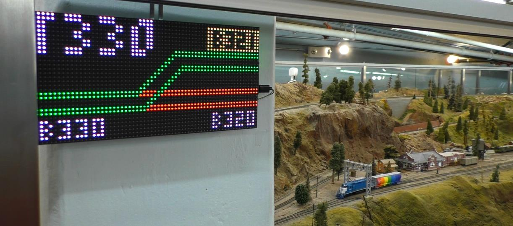

# Distant Signal

**Distant Signal** is a CircuitPython script for an ESP32 to display the state of a remote
model-railroad turnout on a LED Matrix Display.
A small custom language allows one to define the panel display, and then animate it with a simple trigger.
The color and animation script can be loaded from an MQTT broker.

<p align="center">
  <a href="https://www.alfray.com/trains/distant_signal.html">
    
  </a>
  <br/>
  <a href="https://www.alfray.com/trains/distant_signal.html">
    Distant Signal Demonstration at Randall Museum Model Railroad
  </a>
  <br/>
  <i>(Visit the page to view a demonstration video)</i>
</p>


## How it Works

**Distant Signal** is just a “dumb” display panel -- the panel does not know anything about
the model railroad.

The implementation is based around having a JSON file defining a series of layers that
represent blocks or turnout, with the ability to show/hide these layers.
Control is done indirectly via MQTT.

The panel subscribes to specific MQTT topics on the MQTT broker.
To update the panel, a server simply needs to publish messages on the desired MQTT topics.


## Hardware used for this project

- [AdaFruit MatrixPortal CircuitPython ESP32-S3](https://www.adafruit.com/product/5778)
- [AdaFruit 64x32 RGB LED Matrix - 4mm pitch](https://www.adafruit.com/product/2278)
  or equivalent.

The script is fairly customizable. There are many more LED Matrix displays compatible
with the [AdaFruit MatrixPortal](https://learn.adafruit.com/adafruit-matrixportal-s3)
platform that should work.


### ESP32 Setup

Instructions for the [MatrixPortal ESP32-S3](https://learn.adafruit.com/adafruit-matrixportal-s3).
This page has the
[specification, pin out](https://learn.adafruit.com/adafruit-matrixportal-s3/pinouts)
and this page
[explains how to connect the LED Matrix display](https://learn.adafruit.com/adafruit-matrixportal-s3/prep-the-matrixportal).

- I power the Matrix Portal S3 with a 5V 4A USB-C power supply, as recommended.
  However that seems a tad overkill as I have measured the display to consume
  only between 1A and 2A. Note that these displays only update 1 or 2 rows of pixels at a time
  and power usage only depends on the current lines being updated, not the entire display.

- The device should already come with a USB bootloader and create a USB drive visible
  under Windows or Linux.
  If needed follow the
  [instructions to reflash the bootloader](https://learn.adafruit.com/adafruit-matrixportal-s3/factory-reset#factory-reset-and-bootloader-repair-3107941).

- Plug the ESP32, click the reset button, and as the onboard LED becomes purple,
  immediately click the reset button again. If you do it right, the onboard LED should
  stay and remain _green_. A drive named `QTPYS2BOOT` should appear on USB.

- Run the `setup/_get_circuitpy_uf2.sh` script and drop the downloaded `uf2` file on the
  USB drive. Once the device reboot, a USB drive named `CIRCUITPY` should appear.

- Uploading the code on the ESP32 is done by _copying_ files to the USB drive named
 `CIRCUITPY`.
  You can drag'n'drop stuff manually. I prefer to automate things using scripts with MSYS,
  Cygwin, or Git Bash.

- Tip: Open `src/_lib_upload.sh` and `src/_upload.sh`.

  Change the line `D="/d /f /cygdrive/f"` at the beginning to add the drive letter needed
  for your USB drive. For example "F:" is "/f" under MSYS, "/cygdrive/f" under Cygwin,
  or "/media/usb" under Linux.

I run these from the Terminal tab in VS Code:

```
cd src
# upload all libraries (once)
./_lib_upload.sh adafruit_logging
./_lib_upload.sh adafruit_connection_manager
./_lib_upload.sh adafruit_requests
./_lib_upload.sh adafruit_ticks
./_lib_upload.sh adafruit_minimqtt
./_lib_upload.sh adafruit_haslib
./_lib_upload.sh adafruit_matrixportal
./_lib_upload.sh adafruit_bitmap_font
./_lib_upload.sh adafruit_display_text
./_lib_upload.sh neopixel

# upload the fonts, images, and default script (once)
cp ../font/tom-thumb.bdf /circuitpydrive/
cp ../font/tom-thumb2.bdf /circuitpydrive/
cp wifi_off.bmp /circuitpydrive/
cp wifi_on.bmp /circuitpydrive/

# upload source code (after each modification)
./_upload.sh
```

Update settings:

- Open `setup\settings.toml`.
- Open `F:\settings.toml` (or whatever is your CIRCUITPY USB Drive)
- Copy the settings to the USB drive file, and modify as needed to set the SSID/password
  for your wifi and your MQTT server information:

```
# Setting these variables will automatically connect board to WiFi on boot
CIRCUITPY_WIFI_SSID="Your WiFi SSID Here"
CIRCUITPY_WIFI_PASSWORD="Your WiFi Password Here"

# MQTT integration.
MQTT_BROKER_IP=""
MQTT_BROKER_PORT=1883
MQTT_USERNAME="username"
MQTT_PASSWORD="password"
MQTT_TOPIC_ROOT="ambiance"

# DistantSignal Configuration for this panel
MQTT_TURNOUT="Your_Panel_MQTT_ID_Here"
```

### Development and Debugging

To monitor the serial out of the
[AdaFruit MatrixPortal S3](https://learn.adafruit.com/adafruit-matrixportal-s3),
configure VS Code Serial Monitor with Text mode, Port USB, Baud rate 115200, Line ending LF.

Note that whilst the ESP32 resets (after pressing the "reset" button),
VS Code disconnects from the USB port and loses valuable debug information.
Thus you can't debug your script if it fails to load this way.
Instead, the easiest way to debug a broken script is to _upload_ it.
Any upload triggers a soft reboot which reloads the Python VM and exposes any  missing imports:

```
cd src
./_upload.sh
```


## MQTT Interaction

These are the topics that `Distant Signal` subscribes to.

#### Update Configuration Script

```
Topic: "distantsignal/%(T)s/script"
Value: JSON stringified.
```

Where T is MQTT_TURNOUT as defined in `setting.toml`.

This defines the main configuration script for the display panel. 
See next section for syntax.


#### Set Turnout State

```
Topic: "turnout/%(T)s/state"
Value: string
```

Where T is MQTT_TURNOUT as defined in `setting.toml`.

This selects one of the names defined in the `states` section of the configuration script.


#### Set Block State

```
Topic: "block/%(B)s/state"
Value: "active" or "inactive"
```

Where B is the one of the names defined in the `blocks` section of the configuration script.

This selects the state of a given block number.
Blocks are hidden until they are set as either actie or inactive.


## Configuration Script Syntax

See [script_example.json](setup/script_example.json)
and [script_parser.py](src/script_parser.py) for a quick overview.


### JSON Structure

The script is encoded in a JSON structure as follows:
- At the top level, a dictionary with keys "title", "blocks", and "states" is expected.
- At the inner level, we encode graphics primitives for drawing lines, rectangles, polygons, and text,
  which is called a "drawing instruction list".

**Title**: the "title" entry is a single drawing instruction list (see below).
- The title is optional.
- If present, it is always drawn first (bottom z order).

**States**: the "states" entry is a dictionary of named states, each with their own drawing instruction list.
- The states key is optional, or it can be empty.
- States are drawn after (above) the title.
- Distant Signal will then select one state to draw. All others are ignored.
- For example, a panel representing a turnout would typically have 2 states: "normal" and "thrown" (or "reverse"),
  and may define an additional error state. Only one of these states can be selected and drawn at the same time.

**Blocks**: the "blocks" entry is a dictionary of named blocks.
- Each block must have 2 inner keys: "active" and "inactive". Each one is a drawing instruction list.
- Blocks are drawn after (above) the current state.
- For each block defined, Distant Signal will keep an active / inactive status (matching a block being empty or
  occupied).
- If the current state name has the special suffix ":no-blocks", the blocks are not drawn. This is useful for example
  for an initial state (no configuration known) or an error state.
  For example, we would name the error state "error:no-blocks".


### Drawing Instruction List

A drawing instruction list can contain the following primitives:

**Text**:  
`{"op": "text", "x": INT|STR, "y": INT|STR, "t": "TEXT", "rgb": "#RRGGBB", "scale": [1|2], "font": [1|2]}`
- x and y can be either a number or a simple expression with numbers and + and - operations (e.g. "64-26+5").
- Negative numbers are interpreted as offsets from the left/bottom size of the screen.
- "font" and "scale" are optional. When missing, they evaluate to 1.

**Rectangle** (filled):  
`{"op": "rect", "x": INT|STR, "y": INT|STR, "w": INT|STR, "h": INT|STR, "rgb": "#RRGGBB"}`
- x, y, w, and h can be either a number or a simple expression with numbers and + and - operations (e.g. "64-26+5").
- Negative numbers for x and y are interpreted as offsets from the left/bottom size of the screen.

**Line**:  
`{"op": "line", "x1": INT|STR, "y1": INT|STR, "x2": INT|STR, "y2": INT|STR, "rgb": "#RRGGBB"}`
- x1, y1, x2, and y2 can be either a number or a simple expression with numbers and + and - operations (e.g. "64-26+5").
- Negative numbers for x and y are interpreted as offsets from the left/bottom size of the screen.
- Due to the underlying library used, lines are always 2 pixels in width.

**Polygon** (filled, 3 points or more):  
`{"op": "line", pts: [ { "x": INT|STR, "y": INT|STR } * 3+ ], "rgb": "#RRGGBB"}`
- pts is a list of { "x": INT|STR, "y": INT|STR }.
- x, and y can be either a number or a simple expression with numbers and + and - operations (e.g. "64-26+5").
- Negative numbers for x and y are interpreted as offsets from the left/bottom size of the screen.
- There must be at least 3 points, expressed in a consistent perimeter order.
- The polygon is automatically closed.
- The underlying library seem to reasonably handle concave polygons.

**Template**:  
`{ "tmpl": "TEMPLATE_NAME", "vars" : { "VAR1": "VALUE1", ... }, "x": INT|STR, "y": INT|STR}`
- A template injects a top-level drawing instruction list in-place an optional x/y offset and an optional value replacement.
- A top-level key is expected that matches the TEMPLATE_NAME. That key must be a drawing instruction list.
- Any instruction key matching one of the "vars" keys is replaced by the corresponding value before processing.
- x, and y are offsets applied to the template drawing instructions.
  They can be either a number or a simple expression with numbers and + and - operations (e.g. "64-26+5").
- Templates can include other templates; however they should not call back into themselves (infinite loop).

**Comments**:  
`{ "#": "anything here"}`
- JSON does not allow for comments,; instead an instruction with a key "#" is interpreted as a comment and its content ignored.
- Note: in the current implementation, any unknown instruction is ignored (e.g. lacking an "op" key or with an invalid
  operand for "op"). This may be changed later.


## License

License: MIT

https://opensource.org/license/mit

Copyright 2025 (c) ralfoide at gmail

Permission is hereby granted, free of charge, to any person obtaining a copy of this
software and associated documentation files (the “Software”), to deal in the Software
without restriction, including without limitation the rights to use, copy, modify, merge,
publish, distribute, sublicense, and/or sell copies of the Software, and to permit persons
to whom the Software is furnished to do so, subject to the following conditions:

The above copyright notice and this permission notice shall be included in all copies or
substantial portions of the Software.

THE SOFTWARE IS PROVIDED “AS IS”, WITHOUT WARRANTY OF ANY KIND, EXPRESS OR IMPLIED,
INCLUDING BUT NOT LIMITED TO THE WARRANTIES OF MERCHANTABILITY, FITNESS FOR A PARTICULAR
PURPOSE AND NONINFRINGEMENT. IN NO EVENT SHALL THE AUTHORS OR COPYRIGHT HOLDERS BE LIABLE
FOR ANY CLAIM, DAMAGES OR OTHER LIABILITY, WHETHER IN AN ACTION OF CONTRACT, TORT OR
OTHERWISE, ARISING FROM, OUT OF OR IN CONNECTION WITH THE SOFTWARE OR THE USE OR OTHER
DEALINGS IN THE SOFTWARE.

~~
